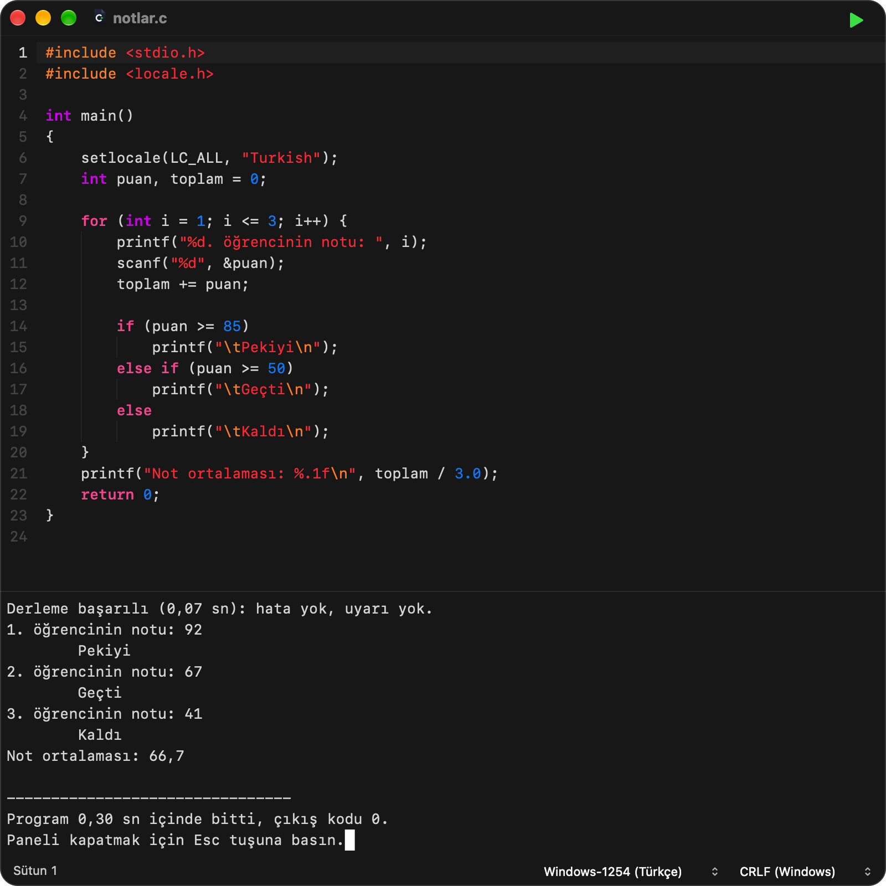
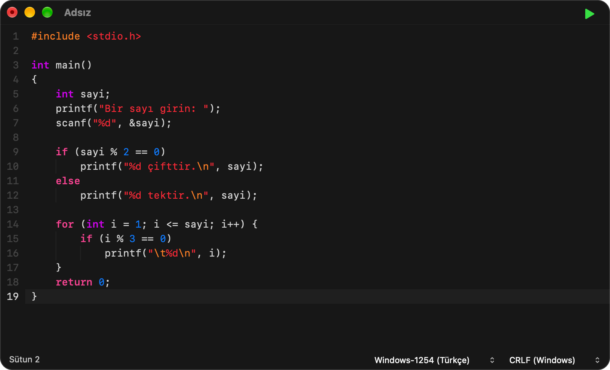
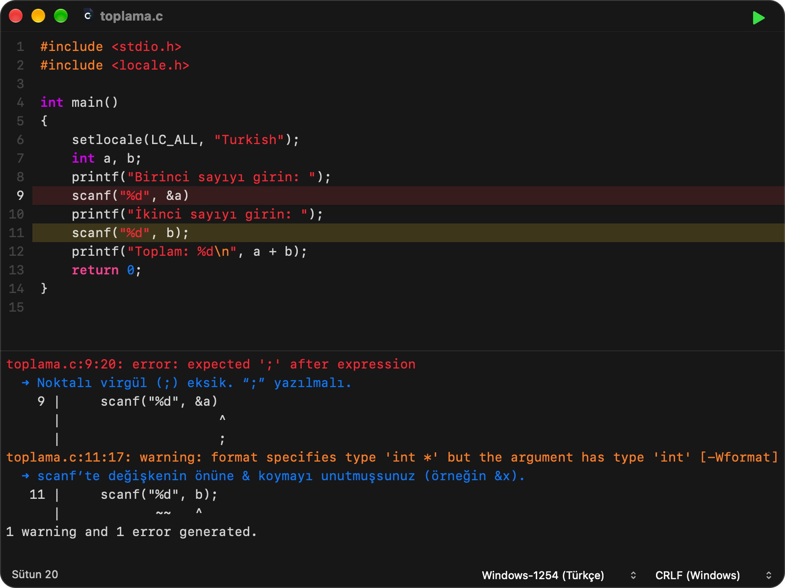

<p align="center">
  
</p>

<h1 align="center">C Editor</h1>

<p align="center">Okulda Windows’ta yazdığın C kodu, Mac’te de çalışsın.</p>

<p align="center">
  <a href="https://github.com/erhansavas/c-editor/actions/workflows/ci.yml"></a>
  <a href="https://github.com/erhansavas/c-editor/releases"></a>
  <a href="LICENSE"></a>
  
</p>

<p align="center">
  
</p>

C çoğu okulda Windows bilgisayarlarda öğretilir. O kod Mac’e gelince genelde çalışmaz: `system("pause")` beklemez,
`getch()` bulunamaz, Türkçe harfler bozulur.

C Editor bu kodu hiç değiştirmeden Mac’te çalıştırır. Kodu yazın ya da açın, **⌘R**’ye basın.

- **Tek tuş:** ⌘R’ye basınca program çalışır, sonucu hemen altta görünür.
- **Türkçe harfler bozulmaz:** Okulda kaydedilen dosya olduğu gibi açılır, çalışır ve kaydedilir.
- **Hatayı Türkçe anlatır:** Nerede olduğunu ve ne yazılması gerektiğini söyler.
- **Kopya vermez:** Kodu sizin yerinize yazmaz; öğrenen sizsiniz.

## Kurulum

macOS 13 Ventura ya da daha yenisi yüklü bir Mac gerekir: Apple çipli (M1 ve sonrası) ya da Intel işlemcili.
2018’den bu yana çıkan bütün Mac’ler ve 2017’nin iMac, MacBook Pro ve MacBook modelleri bunu karşılar.

1. [Sürümler](https://github.com/erhansavas/c-editor/releases) sayfasından `C-Editor-0.6.1.dmg` dosyasını indirin.
2. Açın ve **C Editor**’ü **Applications** klasörüne sürükleyin.
3. İlk açılışta Mac izin isterse: **Sistem Ayarları › Gizlilik ve Güvenlik › Yine de Aç**.
4. İlk ⌘R’de Apple’ın derleyicisinin kurulması istenirse **Kur**’a tıklayın; kurulum bitince ⌘R’ye yeniden basın.

İndirdiğiniz dosyayı doğrulamak isterseniz: `shasum -a 256 -c C-Editor-0.6.1.dmg.sha256`

## Okuldan gelen kod

Bunlar Mac’te de Windows’taki gibi çalışır:

- `system("pause")`, `system("cls")`, `system("cls & pause")` gibi birleşik komutlar ve `> nul`
- `getch()`, `kbhit()` gibi `<conio.h>` komutları
- `Sleep()`, `Beep()` gibi `<windows.h>` komutları
- `setlocale(LC_ALL, "Turkish")` ve Türkçe harfler
- Windows’ta kaydedilmiş dosyada tek karakter sayılan Türkçe harf: `char harf = 'ş';`, `strlen("Şifre")` için 5
- `rand()` ile Windows’taki sayılar; `strrev`, `strupr`, `itoa` gibi fonksiyonlar

Mac’in farklı davrandığı yerde C Editor bunu söyler: Tam sayıyı sıfıra bölen program durur ve nedeni yazılır,
dizinin sınırını aşan satır çıktının altında bildirilir, değer verilmemiş değişken 0 gibi doğru görünen bir sayı okumaz.

## Yazarken

<p align="center">
  
</p>

Boşlukları siz yazmazsınız: Enter’a basınca yeni satır doğru yerden başlar. Soluk çizgiler hangi satırın
hangi bloğa ait olduğunu gösterir.

Yazıyı büyütmek için izleme dörtgeninde, kodun üstünde iki parmağınızı açın; küçültmek için kıstırın. Kod, hata
mesajları ve programın çıktısı birlikte büyür.

## Hata yapınca

<p align="center">
  
</p>

İmleç hatalı satıra gider ve altında ne yazmanız gerektiği Türkçe çıkar. Program çökerse nedenini söyler.

## Kısayollar

| | |
| --- | --- |
| **⌘R** | Çalıştır |
| **Ctrl+C** | Çalışan programı durdur |
| **Esc** | Program bitince alttaki paneli kapat |
| **⌘N** | Yeni dosya |
| **⌘O** | Aç |
| **⌘S** | Kaydet |
| **İki parmakla aç / kıstır** | Yazıyı büyüt / küçült |

## Nerede denendi

Her sürümün DMG’si yayımlanmadan önce aşağıdaki yerlerde denenir. Burada yazılı olmayan bir Mac’te ya da macOS sürümünde
denenmemiştir.

| Ne denendi | Nerede |
| --- | --- |
| Bütün testler: düzenleyici, gerçek programların derlenip çalıştırılması, Türkçe metin, açıklamalar | macOS 27, Apple M4 |
| Aynı testler ve pencereler, uygulamanın Intel kodu ile | Aynı Mac’te Rosetta ile; gerçek bir Intel işlemcide değil |
| DMG’deki uygulamanın açılması; DMG’nin içindeki başlık dosyaları ve kitaplıkla aynı testler | GitHub’ın `macos-15-intel` (macOS 15, gerçek Intel işlemci) ve `macos-15` (macOS 15, Apple çipli) makineleri; her birinde Xcode 16.0’dan 26.3’e bütün derleyicilerle |

macOS 13 ve 14’te hiçbir deneme yapılamadı: GitHub artık bu sürümleri sunmuyor. Uygulama macOS 13 için derlenir ve
derleyici, macOS 13’te bulunmayan hiçbir sistem özelliğinin kullanılmasına izin vermez. Programlarınıza eklenen
kitaplık hazır gelmez; ilk ⌘R’de Mac’inizin kendi derleyicisiyle bir kez derlenir, böylece eski bir derleyiciyle de uyuşur.
Bu sürümlerde bir sorun görürseniz lütfen yazın.

## Sorun mu var?

[Buradan](https://github.com/erhansavas/c-editor/issues) yazın. Hangi kodu yazdığınızı, ne beklediğinizi ve
Mac’inizin macOS sürümünü eklemeniz yeterli.

## Kaynaktan derlemek

macOS 26 ya da daha yenisi ve Xcode 26 ya da daha yenisi yüklü bir Mac’te (Apple çipli ya da Intel):

```sh
./build.sh test        # testler
./build.sh             # uygulama: build/release/C Editor.app
./build.sh --install   # derler ve /Applications klasörüne koyar
```

Başka hiçbir şey kurmak gerekmez. Testler macOS 15 ve Xcode 16 ile de çalışır; uygulamanın simgesini derleyen Apple
aracı macOS 26 ister.

---

Lisans: [Apache 2.0](LICENSE). Değişiklikler: [CHANGELOG.md](CHANGELOG.md).
